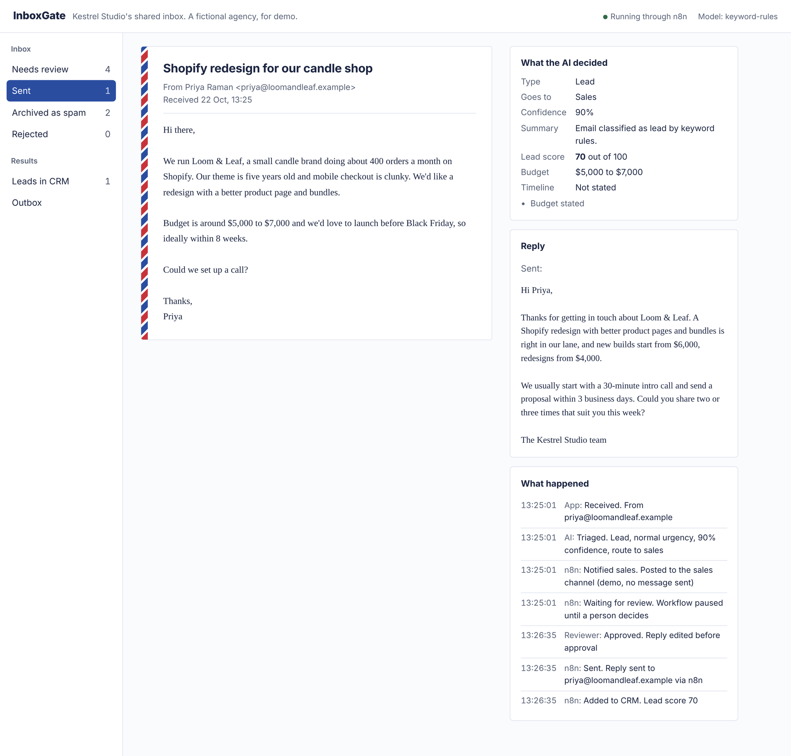
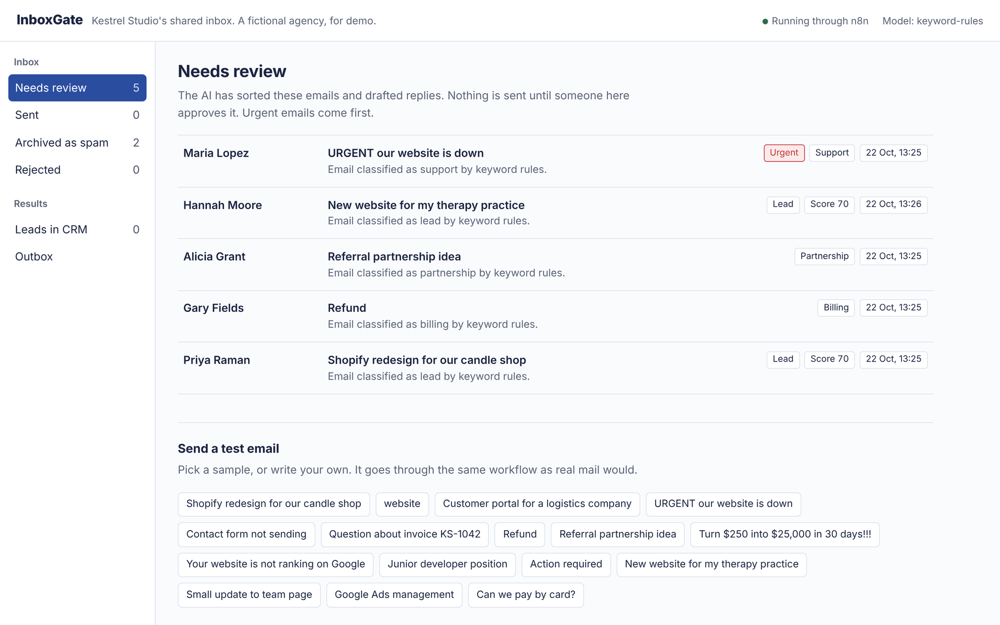
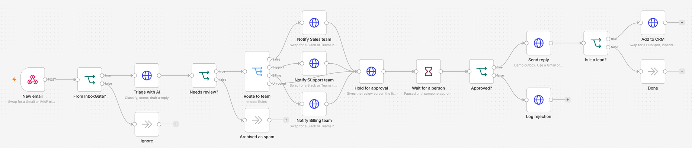
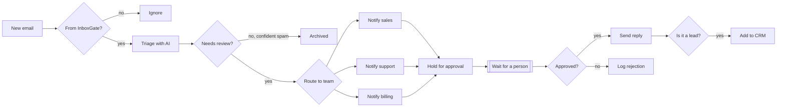

# InboxGate

AI triage for a shared business inbox, with a person approving every reply before it goes out.

Each new email is classified (lead, support, billing, partnership, spam or other), routed to the right team, and given a drafted reply. Leads get their budget, timeline and requested services pulled out and a fit score. Then the n8n workflow **pauses** until someone reviews the draft, edits it if needed, and approves or rejects it. Approved replies are sent and approved leads are added to the CRM. Every step is logged.

The demo runs on the inbox of **Kestrel Studio, a fictional web agency**. The agency, its prices and the sample emails are made up.

- Live demo: https://inboxgate.onrender.com (free hosting that sleeps when idle, so the first load can take up to a minute)





<sub>Local run through real n8n 2.44, using the offline keyword model instead of Gemini, so the AI summaries read "classified by keyword rules". The reply in the first screenshot was written by the reviewer during the test. Screenshots with real Gemini triage will replace these after deployment.</sub>

## The workflow



The same flow as a diagram:



The workflow file is `n8n/inboxgate-workflow.json`. It was tested end to end on n8n 2.44.5: approve, reject, auto-archived spam, and a request with the wrong token.

## How the pieces split

**n8n runs the process.** Trigger, routing, the wait for a human, sending and the CRM update are n8n nodes. In this demo they call the app's API. In a real setup you swap nodes, not code: the webhook for a Gmail or IMAP trigger, "Notify team" for Slack, "Send reply" for Gmail or SMTP, "Add to CRM" for HubSpot or a Google Sheet.

**The Python app does the AI part and the review screens.** The triage logic lives in code because it needs things that are awkward in a workflow editor: a strict output schema, a retry when the model returns invalid JSON, a safe fallback, and tests.

## What keeps it safe

- **Nothing is sent without a person.** The workflow waits on n8n's Wait node, and the review screen resumes it with the decision. Only confident spam skips review, and the threshold is configurable.
- **Drafts can only use the agency's facts.** The model gets a short agency profile and is told not to invent prices, dates, refunds or availability. When something needs a decision, it leaves a placeholder like `[proposed call times]` and explains it in a note to the reviewer.
- **Validated output.** The model's JSON is checked against a schema: categories, score range, required fields. Invalid output gets one retry with the error. If that fails too, the email is marked "other" with no draft, so a person always handles it.
- **Emails are untrusted.** Instructions inside an email are ignored, and emails that try to instruct the AI are treated as spam. One of the samples tests this.
- **No double sends.** Sending is idempotent, so an n8n retry can't send a reply twice, and a ticket can't be approved after it's been rejected.
- **Works without n8n.** If n8n can't be reached when someone approves, the app finishes the job itself and logs that it did.
- **Audit trail.** Each email shows what the AI decided, when the workflow paused, who approved, whether the draft was edited, and what was sent.

## Demo limits

- **No real email is sent.** Approved replies go to an Outbox page. This is on purpose, so a public demo can't be used to send email.
- The review screens are open unless `REVIEW_PASSWORD` is set. Set it before using this with real mail.

## Stack

| Part | Choice |
| --- | --- |
| Workflow | n8n (Webhook, If, Switch, Wait, HTTP Request nodes) |
| AI and review screens | Python, FastAPI, Jinja templates |
| Model | Gemini over HTTPS, with retries on rate limits |
| Database | Postgres (Supabase on the hosted demo) |
| Hosting | Render for the app and for n8n |
| Tests | pytest against a real Postgres, GitHub Actions |

## Run it locally

With Docker:

```bash
cp .env.example .env     # add GEMINI_API_KEY and any long random WORKFLOW_TOKEN
docker compose up
```

1. Open n8n at http://localhost:5678 and create your owner account.
2. Import `n8n/inboxgate-workflow.json` and publish it.
3. Open http://localhost:8000 and send one of the sample emails.

Without Docker or n8n, the app works on its own (it triages and sends directly). You need Python 3.12+ and a Postgres database:

```bash
cd api
cp .env.example .env     # set DATABASE_URL; LLM_PROVIDER=fake runs with no API key
pip install -r requirements-dev.txt
uvicorn app.main:app --reload
```

`LLM_PROVIDER=fake` swaps the model for keyword rules. It's there so tests and the UI run with no key. Its drafts aren't meant to be good.

Tests need a Postgres database: set `TEST_DATABASE_URL` and run `pytest` from `api/`.

## Deploy

`render.yaml` defines two services, the app and n8n, sharing one Supabase database: the app in the `public` schema, n8n in an `n8n` schema.

1. Create a Supabase project and run `create schema if not exists n8n;` in its SQL editor. Note the Session pooler host and user.
2. In Render, create two environment groups. `gemini` holds `GEMINI_API_KEY`. `supabase` holds `DATABASE_URL` (pooler URL without the password, ending in `?sslmode=require`), `PGPASSWORD`, `DB_POSTGRESDB_HOST`, `DB_POSTGRESDB_USER` and `DB_POSTGRESDB_PASSWORD`.
3. Create a Blueprint from this repo. The token linking the app and n8n is generated and shared automatically.
4. Set `N8N_INBOUND_URL` on the app to the n8n URL plus `/webhook/inboxgate-inbound`, and `INBOXGATE_API_URL` on n8n to the app's URL.

The n8n image in `n8n/` imports and publishes the workflow whenever the deployed version doesn't match the repo, so a fresh instance runs it without anyone opening the editor. It records the version it published in the database, so ordinary restarts skip that step and start in about a minute. n8n unpublishes a workflow if activating it fails (a database timeout is enough), so a small watchdog checks the webhook every minute and restarts n8n if it goes missing; the restart publishes it again. Emails sent in the meantime are triaged by the app directly, and the audit trail says so. To look at the workflow in the n8n editor, open the n8n URL and create an owner account.

Render's free tier sleeps after 15 minutes without traffic, so the first email after a quiet spell can take up to a minute.

## Sample emails

`api/samples/emails.json` has 16 emails covering every category, an urgent outage, a lead for a service the agency doesn't offer, a refund request the draft must not promise, and a prompt-injection attempt. Each has the category it should get, so they double as a test set.

## License

MIT
